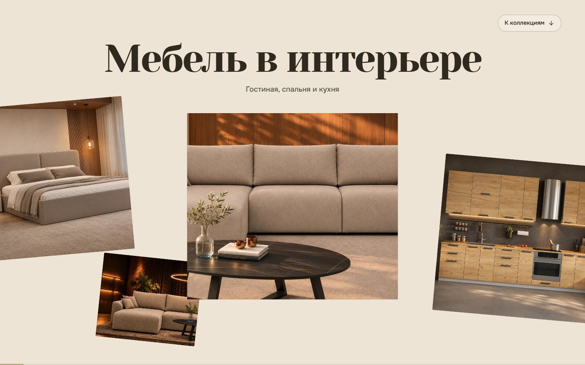

# Зона Комфорта · интерьерная сцена

[Открыть главную](https://ttwixxbot.github.io/ksytop-showroom-kabizzu/) · [Перейти сразу к сцене](https://ttwixxbot.github.io/ksytop-showroom-kabizzu/#interior-story)

Фотоколлаж расположен между категориями и коллекциями. При прокрутке боковые кадры сходятся к центру, гостиная с «Бостоном» заполняет экран. Прокрутка вверх обращает переход. Для телефона используется вертикальный кадр. В режиме уменьшенного движения показывается статичная композиция.

В репозитории хранится статический экспорт Next.js. Сценой управляет GSAP ScrollTrigger. Предпросмотр доступен по ссылке и помечен noindex. Форма консультации открывает черновик в почтовом приложении. Изображения мебели принадлежат соответствующим правообладателям.

Клонируйте репозиторий в папку ksytop-showroom-kabizzu. Из родительской папки запустите команду для просмотра.

    python -m http.server 4195 --bind 127.0.0.1

[Открыть локальную главную](http://127.0.0.1:4195/ksytop-showroom-kabizzu/)

Режиссура фотоколлажа вдохновлена [Kabizzu от Piton Studios](https://www.pitonstudios.com/en/projects/kabizzu).
