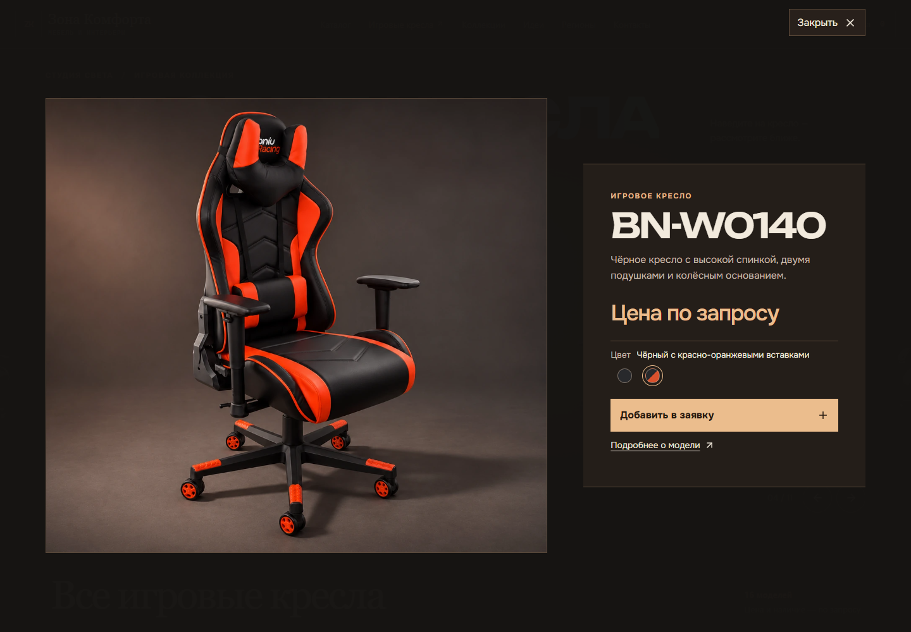
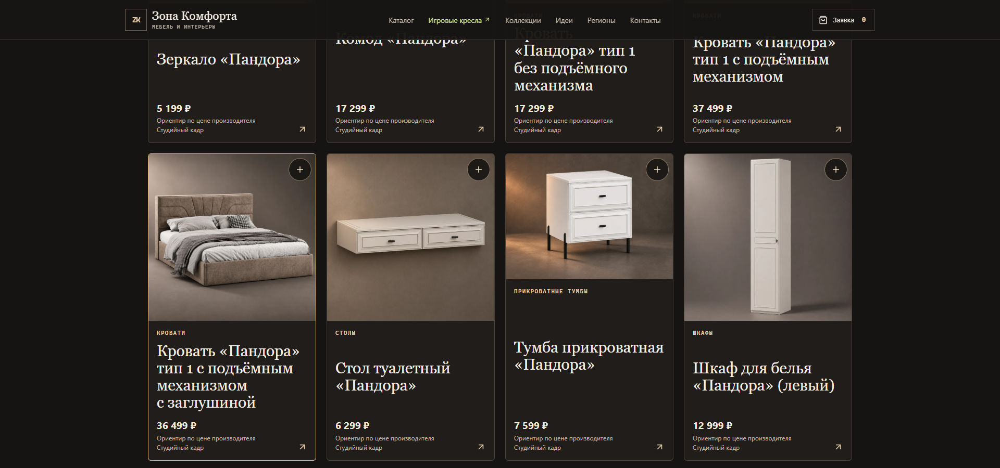
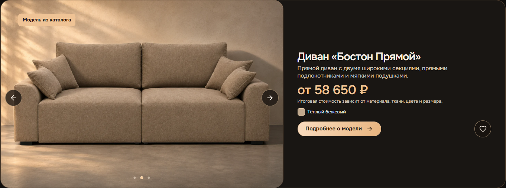
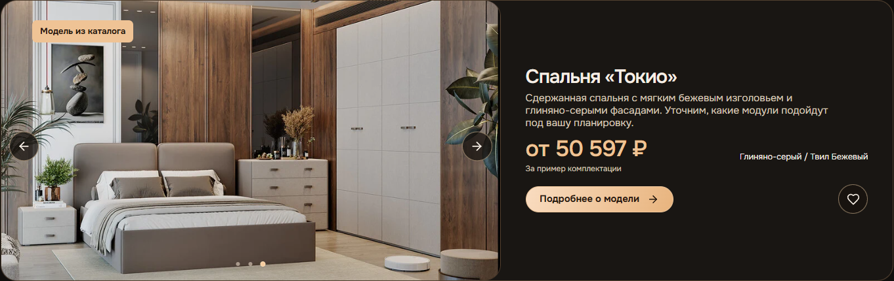

# Зона Комфорта — мебельный каталог

[Открыть сайт](https://ttwixxbot.github.io/ksytop-showroom-kabizzu/) · [Каталог](https://ttwixxbot.github.io/ksytop-showroom-kabizzu/catalog/) · [Политика конфиденциальности](https://ttwixxbot.github.io/ksytop-showroom-kabizzu/privacy/)


Обновление 24 ноября 2026. Каталог и виртуальный мебельный шоурум с подборками, поиском, фильтрами по категориям и цене, галереями и избранным. Это каталог без онлайн-оплаты.

## Последние исправления

- На главной исправлен блок «Модель из каталога»: все три фотографии видны целиком; исходные размеры задают высоту области. На узком планшете текст расположен под фото.
- По фотографиям ценников добавлены цены 15 кресел и 8 диванов. На кресла указана точная цена, одинаковая для цветов одной модели; остальные известные цены отображаются с «от». У диванов объяснена зависимость стоимости от материала, ткани, цвета и размера.
- Рамка товарной фотографии повторяет пропорции исходного снимка: полное изображение без чёрных полос и обрезки. При наведении второй ракурс показывается только при совпадении пропорций.
- Исправлены обложки 34 предметов спальни: первым снова показывается полный студийный вид, а не фрагмент дверцы. Снимки деталей остаются внутри галереи.
- Товарные изображения и миниатюры показываются целиком без увеличения с обрезкой при наведении. Галерея учитывает размеры каждого файла заранее.
- Варианты отделки без собственной фотографии перечислены текстом. Переключатели с миниатюрами доступны только для исполнений с разными фотографиями; условные цветные значки и сообщения об отсутствующем фото убраны.
- Сортировка: по возрастанию цены, по убыванию цены, сначала популярные, сначала новинки. Используются существующие отметки isPopular/isNew; вымышленные даты и рейтинги не добавлялись.
- Переходы из похожих товаров начинают новую карточку сверху, включая переходы во время инерционной прокрутки. Возврат в каталог сохраняет фильтры и положение.
- Красно-оранжевый BN-W0140 получил студийный кадр вместо неудачной вырезки. Он используется и при выборе этого исполнения в карточке. Оригиналы хранятся отдельно.









## Что работает

- 335 моделей; 49 кухонь из актуального предоставленного каталога.
- Поиск, сортировка цен, сохранение фильтров и возврат из товара к прежней позиции каталога.
- Галереи с реальными вариантами, свайпом и клавиатурным управлением.
- Подборка: добавление, изменение количества, удаление, скачивание текстового списка.
- Главная с автоматической сменой кадров и интерьерной сценой по прокрутке. Для reduced motion предусмотрено упрощение.
- Политика конфиденциальности и компактное уведомление cookies. Аналитика и реклама не подключены.
- Ссылка «Диваны для дома» открывает каталог диванов; услуга переобивки не предлагается.

## Статус публикации

Пока не подтверждены контакты получателя, реквизиты владельца и условия приёма обращений, отправка заявок отключена. Подборку можно скачать. Неуказанные цены отображаются как «Цена по запросу». Индексация предпросмотра отключена. Размещение этой версии не означает завершения настройки коммерческого приёма заявок.

## Проверки

Цены с фотографий: сопоставлено 23 модели (15 кресел, 8 диванов). Проверены все 335 подписей цен, оба направления сортировки и числовой диапазон, точные/начальные/неизвестные суммы подборки и скачивание списка. Прочие бирки без точного совпадения модели не использованы. Фото блока «Модель из каталога»: все 3 слайда на 1920/1440/1024/768/390/360, без обрезки и полей; проверены обычное движение и reduced motion.

Фоторамки: все 335 товаров на 1920/1440/768/390/360 px, 7 подборок спальни и 6 коллекций на каждом размере; 3625 проверок геометрии изображений. Сравнивается фактическая область снимка с рамкой по обеим осям, чтобы исключить поля и обрезку. Возврат из середины каталога проверен на desktop/mobile.

Проверка товарных фотографий после исправления обложек: все 335 плиток на 1440/1920/768/390 px, основные галереи всех 335 товаров на desktop и по 51 странице на tablet/mobile; миниатюры, hover, смена кадров, отсутствие 404 и горизонтального переполнения. Проверены размеры 1756 файлов. Снимки деталей остаются крупными планами в галерее.

Локальный аудит: 395 адресов на двух размерах экрана (790 успешных браузерных проверок), 2266 файлов изображений, 189 переключений вариантов, сценарии desktop/tablet/mobile. Перед этой публикацией дополнительно проверены пути с префиксом репозитория, новая ссылка диванов, карточка, галерея, подборка, кухни, политика и cookies на 1440×900 и 390×844.

Зависимости исходной сборки обновлены, npm audit не выявил известных уязвимостей на дату проверки. HTML содержит CSP с хешами разрешённых встроенных скриптов. GitHub Pages не поддерживает произвольные HTTP security headers; TLS обеспечивается хостингом. Проверки не являются инфраструктурным пентестом или проверкой доставки почты.

## Устройство репозитория

Здесь хранится готовый статический export Next.js 15.5.29. `_next` — JavaScript, стили и шрифты; `images` — материалы каталога; папки разделов — HTML и данные страниц. Изображения и шрифты загружаются с этого же сайта. Для каталога не требуются API-ключи или сторонние сервисы во время просмотра.

Папка при клонировании должна называться `ksytop-showroom-kabizzu`, поскольку сборка использует такой URL-префикс. Из родительской папки:

```sh
python -m http.server 4195 --bind 127.0.0.1
```

Затем открыть http://127.0.0.1:4195/ksytop-showroom-kabizzu/ . Отдельная сборка из JSX в этом репозитории не предусмотрена: опубликован готовый export.

Изображения мебели и материалы принадлежат соответствующим правообладателям. Лицензии шрифтов находятся в `licenses`. Разрешение на повторное использование остальных материалов отдельно не предоставляется. Режиссура интерьерной сцены вдохновлена проектом [Kabizzu от Piton Studios](https://www.pitonstudios.com/en/projects/kabizzu); каталог и данные относятся к «Зоне Комфорта».
