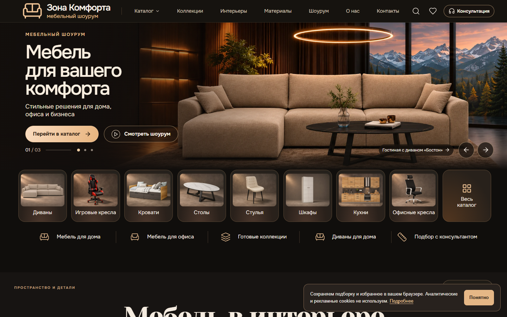

# Зона Комфорта — мебельный каталог

[Открыть сайт](https://ttwixxbot.github.io/ksytop-showroom-kabizzu/) · [Каталог](https://ttwixxbot.github.io/ksytop-showroom-kabizzu/catalog/) · [Политика конфиденциальности](https://ttwixxbot.github.io/ksytop-showroom-kabizzu/privacy/)



Обновление 24 ноября 2026. Каталог и виртуальный мебельный шоурум с подборками, поиском, фильтрами по категориям и цене, галереями и избранным. Это каталог без онлайн-оплаты.

## Что работает

- 335 моделей; 49 кухонь из актуального предоставленного каталога.
- Поиск, сортировка цен, сохранение фильтров и возврат из товара к прежней позиции каталога.
- Галереи с реальными вариантами, свайпом и клавиатурным управлением.
- Подборка: добавление, изменение количества, удаление, скачивание текстового списка.
- Главная с автоматической сменой кадров и интерьерной сценой по прокрутке. Для reduced motion предусмотрено упрощение.
- Политика конфиденциальности и компактное уведомление cookies. Аналитика и реклама не подключены.
- Ссылка «Диваны для дома» открывает каталог диванов; услуга переобивки не предлагается.

## Статус публикации

Пока не подтверждены контакты получателя, реквизиты владельца и условия приёма обращений, отправка заявок отключена. Подборку можно скачать. Неуказанные цены отображаются как «Цена по запросу». Индексация предпросмотра отключена. Размещение этой версии не означает завершения настройки коммерческого приёма заявок.

## Проверки

Локальный аудит: 395 адресов на двух размерах экрана (790 успешных браузерных проверок), 2266 файлов изображений, 189 переключений вариантов, сценарии desktop/tablet/mobile. Перед этой публикацией дополнительно проверены пути с префиксом репозитория, новая ссылка диванов, карточка, галерея, подборка, кухни, политика и cookies на 1440×900 и 390×844.

Зависимости исходной сборки обновлены, npm audit не выявил известных уязвимостей на дату проверки. HTML содержит CSP с хешами разрешённых встроенных скриптов. GitHub Pages не поддерживает произвольные HTTP security headers; TLS обеспечивается хостингом. Проверки не являются инфраструктурным пентестом или проверкой доставки почты.

## Устройство репозитория

Здесь хранится готовый статический export Next.js 15.5.29. `_next` — JavaScript, стили и шрифты; `images` — материалы каталога; папки разделов — HTML и данные страниц. Изображения и шрифты загружаются с этого же сайта. Для каталога не требуются API-ключи или сторонние сервисы во время просмотра.

Папка при клонировании должна называться `ksytop-showroom-kabizzu`, поскольку сборка использует такой URL-префикс. Из родительской папки:

```sh
python -m http.server 4195 --bind 127.0.0.1
```

Затем открыть http://127.0.0.1:4195/ksytop-showroom-kabizzu/ . Отдельная сборка из JSX в этом репозитории не предусмотрена: опубликован готовый export.

Изображения мебели и материалы принадлежат соответствующим правообладателям. Лицензии шрифтов находятся в `licenses`. Разрешение на повторное использование остальных материалов отдельно не предоставляется. Режиссура интерьерной сцены вдохновлена проектом [Kabizzu от Piton Studios](https://www.pitonstudios.com/en/projects/kabizzu); каталог и данные относятся к «Зоне Комфорта».
